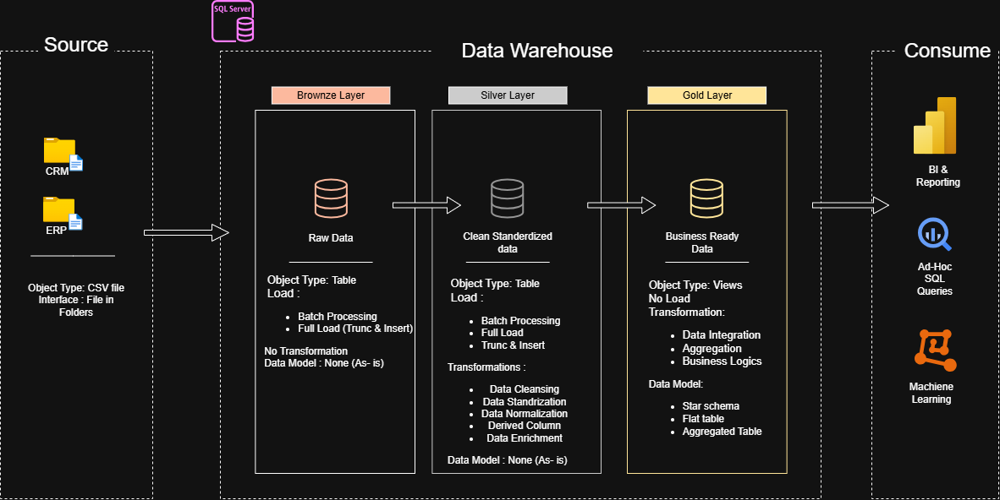

# Data Warehouse and Analytics Project

Welcome to the **Data Warehouse and Analytics Project** repository! 🚀

This project demonstrates a comprehensive data warehousing and analytics solution, from building a data warehouse to generating actionable insights. Designed as a portfolio project, it highlights industry best practices in data engineering and analytics.

---

## 🚀 Project Requirements

### Building the Data Warehouse (Data Engineering)

#### Objective

Develop a modern data warehouse using SQL Server to consolidate sales data, enabling analytical reporting and informed decision-making.

#### Specifications

- **Data Sources:** Import data from two source systems (ERP and CRM) provided as CSV files.
- **Data Quality:** Cleanse and resolve data quality issues prior to analysis.
- **Integration:** Combine both sources into a single, user-friendly data model designed for analytical queries.
- **Scope:** Focus on the latest dataset only; historization of data is not required.
- **Documentation:** Provide clear documentation of the data model to support both business stakeholders and analytics teams.

---

### 📊 BI: Analytics & Reporting (Data Analytics)

#### Objective

Develop SQL-based analytics to deliver detailed insights into:

- **Customer Behavior**
- **Product Performance**
- **Sales Trends**

These insights empower stakeholders with key business metrics, enabling strategic decision-making.

---
🏗️ Data Architecture
The data architecture for this project follows Medallion Architecture, which consists of three layers: Bronze, Silver, and Gold.


1. Bronze Layer: Stores raw data as-is from the source systems. Data is ingested from CSV files into the SQL Server database.

2. Silver Layer: This layer includes data cleansing, standardization, and normalization processes to prepare data for analysis.

3. Gold Layer: Houses business-ready data modeled into a Star Schema required for reporting and analytics.

## 📂 Repository Structure

```text
SQL-Data-Warehouse-Project/
│
├── 00_setup/                   # Database setup and environment configuration
│
├── 01_datasets/                # Source CSV files
│   ├── source_crm/             # CRM source data
│   └── source_erp/             # ERP source data
│
├── 02_docs/                    # Project documentation and diagrams
│   ├── data_architecture.png
│   ├── data_flow.png
│   ├── data_model.png
│   ├── data_catalog.md
│   ├── requirements.md
│   └── naming_conventions.md
│
├── 03_scripts/                 # SQL scripts for data warehouse development
│   ├── init_database.sql       # Database and schema initialization
│   │
│   ├── bronze/                 # Bronze Layer scripts
│   │   ├── ddl_bronze.sql
│   │   └── proc_load_bronze.sql
│   │
│   ├── silver/                 # Silver Layer scripts
│   │   ├── ddl_silver.sql
│   │   └── proc_load_silver.sql
│   │
│   └── gold/                   # Gold Layer scripts
│       └── ddl_gold.sql
│
└── 04_tests/                   # Data quality checks
    ├── quality_checks_silver.sql
    └── quality_checks_gold.sql
```

### 📌 Folder Description

- **00_setup:** Contains database setup instructions and environment configuration.
- **01_datasets:** Contains the raw CSV files obtained from CRM and ERP source systems.
- **02_docs:** Contains project documentation, data architecture diagrams, data models, and data catalogs.
- **03_scripts:** Contains SQL scripts for database initialization, table creation, and ETL operations across Bronze, Silver, and Gold layers.
- **04_tests:** Contains SQL scripts for validating data quality across the Silver and Gold layers.

## 🛡️ License

This project is licensed under the [MIT License](LICENSE). You are free to use, modify, and share this project with proper attribution.

---


## 🌟 About Me

Hi there! I'm **Aryan Chougule**, passionate about Data Engineering, Data Analytics, and Artificial Intelligence & Machine Learning (AI/ML).

I'm building this project as a stepping stone in my learning journey, strengthening my technical skills and gaining hands-on experience in data warehousing, SQL, and analytics.

My goal is to build practical projects, solve real-world data problems, and continuously grow as an aspiring AI/ML Engineer.

Thanks for visiting my repository! 🚀
